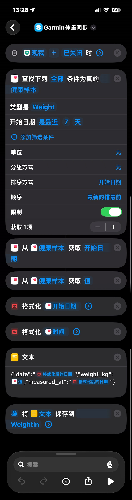

# Weight Scale → Garmin Connect Auto Sync

English | [简体中文](README.zh-CN.md)

> Weigh yourself → iPhone Shortcut → iCloud Drive → Mac watcher → FIT file → Garmin Connect. No manual steps required.

## Contents

- [Why this project](#why-this-project)
- [Requirements](#requirements)
- [Runtime environment](#runtime-environment)
- [Setup](#setup)
- [Configuration](#configuration)
- [How it works](#how-it-works)
- [Troubleshooting](#troubleshooting)
- [Security and privacy](#security-and-privacy)
- [Repository layout](#repository-layout)
- [Known limitations](#known-limitations)
- [License](#license)

## Why this project

Garmin Connect does not automatically read weight back from Apple Health. A scale can write weight into Apple Health, but that weight does not automatically appear in Garmin Connect.

This project fills that gap: it acts as a small data mover that takes the latest weight from Apple Health and uploads it to Garmin Connect as a FIT file.

## Requirements

### Required

| Item | Requirement | Notes |
| --- | --- | --- |
| Weight scale | A scale or app that writes weight to Apple Health | Tested with **ScaleMe (观我) + Ant Afu co-branded scale**. Any source that writes weight to Health should work. |
| iPhone | Can run Shortcuts and has the Health app | The Shortcut needs permission to read Health data. |
| Mac | macOS; can stay online, or at least be online during the active windows | Runs the watcher and the launchd job. Tested on an Apple Silicon MacBook Pro. |
| iCloud Drive | iPhone and Mac signed in to the **same Apple ID** with iCloud Drive enabled | Used to transfer files between the Shortcut and the Mac. |
| Garmin Connect account | International region (`connect.garmin.com`) | China-region accounts have not been tested. |
| Network | The Mac can reach the internet and Garmin servers | Needed for uploads and iCloud synchronization. |

### Prerequisites

1. **The scale must write weight into Apple Health.** This is the start of the chain; if the scale app does not write to Health, the Shortcut has nothing to read.
2. **The iPhone must be unlocked when the Shortcut is triggered.** Health data is unavailable while the phone is locked.
3. **The iPhone and Mac must use the same iCloud account**, otherwise the `WeightIn` folder will not sync to the Mac.
4. **The Mac must be powered on and online during an active window.** Otherwise files wait until the next window or the next boot.

## Runtime environment

- **macOS**: any recent version with launchd.
- **Python**: 3.11 or newer; tested with 3.13. A virtual environment is recommended.
- **Python packages**: `garminconnect` (0.3.x; tested with 0.3.20) and `curl_cffi` (a garminconnect dependency, also installed explicitly here).

```bash
cd ~/GarminWeightSync
python3 -m venv venv
./venv/bin/pip install garminconnect curl_cffi
```

Run these commands after cloning the repository to `~/GarminWeightSync`; see the setup steps below.

- **Directory layout** (using `~/GarminWeightSync`; if you use a different path, update the plist too):

```text
~/GarminWeightSync/
├── scripts/                 # source code
│   ├── watcher.py           # watcher
│   ├── login_once.py        # one-time login
│   ├── fit_weight.py        # FIT generator (must stay next to watcher.py)
│   └── com.user.weighin.plist
├── docs/                    # deployment and Shortcut documentation
│   ├── index.md
│   ├── mac-setup.md
│   └── shortcut-icloud.md
├── Logs/                    # runtime files (created automatically)
│   ├── weighin.log
│   ├── weighin.err
│   └── uploaded.json
└── venv/                    # Python virtual environment

# One file lives outside the project directory:
#   ~/Library/LaunchAgents/com.user.weighin.plist   # launchd job
```

## Setup

The examples use `~/GarminWeightSync` as the project directory and `WeightIn` as the iCloud folder. Replace the example email and paths with your own. A shorter Mac setup checklist is available in `docs/mac-setup.md`.

### Step 1: Create the iCloud folder

1. On iPhone, open Files → iCloud Drive and create a folder named exactly **`WeightIn`**.
   - Do not add a leading space. `" WeightIn"` is a different folder and the Mac will not find it.
2. On Mac, confirm that System Settings → Apple ID → iCloud Drive is enabled.
3. Wait for the folder to appear on the Mac (same Apple ID required):

```bash
ls ~/Library/Mobile\ Documents/com~apple~CloudDocs/WeightIn
```

If the folder does not appear, save any file into `WeightIn` from the iPhone Files app to verify that iCloud synchronization works.

### Step 2: Get the code and create a virtual environment

```bash
# Clone the repository (or download a source archive) to ~/GarminWeightSync
git clone https://github.com/elingsoft/GarminWeightSync4iCloud.git ~/GarminWeightSync
cd ~/GarminWeightSync
python3 -m venv venv
./venv/bin/pip install garminconnect curl_cffi
```

The repository already contains the `scripts/` directory, so no manual copying is needed. `watcher.py` adds its own directory to the module search path; `fit_weight.py` must remain in the same directory or the import will fail.

### Step 3: Log in to Garmin once

```bash
cd ~/GarminWeightSync/scripts
GARMIN_EMAIL=your-garmin-email ~/GarminWeightSync/venv/bin/python login_once.py
```

- Enter the password through `getpass`; it is not echoed and is **not written to disk**.
- If MFA is enabled, enter the one-time code when prompted.
- On success, the script prints `Login OK, tokens cached`. Tokens are saved to `~/.garminconnect/garmin_tokens.json` with mode `0600`.
- The watcher no longer needs the password and the library refreshes tokens automatically. If the token becomes invalid, rerun this step; the next round retries the upload.

### Step 4: Configure the watcher

The main watcher settings are at the top of `watcher.py` and in environment variables:

| Setting | Location | Default | Description |
| --- | --- | --- | --- |
| `GARMIN_EMAIL` | Environment variable (also set in the plist) | Empty | Garmin login email |
| `WEIGHIN_DIR` | Environment variable | `~/Library/Mobile Documents/com~apple~CloudDocs/WeightIn` | Folder to watch |
| `ACTIVE_WINDOWS` | Constant in `watcher.py` | `[(5, 0, 9, 0), (20, 0, 22, 0)]` | Processing windows; use `None` to run all day |
| `MIN_AGE_S` | Constant in `watcher.py` | `60` | Skip files younger than this many seconds |
| `DEDUP_TOL` | Constant in `watcher.py` | `0.05` | Duplicate tolerance in kg |

Each window is `(start_hour, start_minute, end_hour, end_minute)`; the end time is exclusive. For example, `(5, 0, 9, 0)` covers 5:00–9:00, and 9:00 itself is outside the window.

### Step 5: Install the launchd job

```bash
# Copy the plist from the repository's scripts/ directory
cp ~/GarminWeightSync/scripts/com.user.weighin.plist ~/Library/LaunchAgents/

# Edit ~/Library/LaunchAgents/com.user.weighin.plist and check four things:
#   1. ProgramArguments: absolute paths to Python and scripts/watcher.py
#   2. WorkingDirectory: the scripts/ directory
#   3. EnvironmentVariables: replace you@example.com with your Garmin email
#   4. StandardOutPath / StandardErrorPath: writable log paths

# Load and verify
launchctl load ~/Library/LaunchAgents/com.user.weighin.plist
launchctl list | grep weighin
```

The template still contains old paths in `ProgramArguments`, `WorkingDirectory`, and the log settings. Update all four items before loading it.

- `launchctl list` should show `- 0 com.user.weighin`. A status of `- 78` means a configuration error (EX_CONFIG), most often because the paths in the plist do not match the real layout. Fix the four items, then `unload` and `load` again.
- The watcher scans every 60 seconds; activity appears in `Logs/weighin.log`.

### Step 6: Build the iPhone Shortcut

#### Trigger (choose one)

- Preferred: run when ScaleMe closes. The phone must be unlocked at that moment because Health data is unavailable while locked.
- Alternative: run when the morning alarm stops.

#### Actions (in order)

1. **Find Health Samples**: type `Weight` (体重), sort by `Start Date` (开始日期), newest first, limit 1.
2. **Get Details of Health Sample** → Start Date.
3. **Get Details of Health Sample** → Value.
4. **Format Date**: input from step 2, custom format `yyyy-MM-dd`.
5. **Text**, building JSON with variables (do not hard-code the numbers):

```json
{"date":"2026-11-04","weight_kg":55.6}
```

6. **Save File**: save the text to `WeightIn`, disable Ask Where To Save, enable Overwrite If File Exists, and set the subpath to `weighin-` + the formatted date from step 4 + `.json`.

#### Optional: include the actual measurement time

To show the real measurement time instead of the 07:00 fallback, add:

1. Another **Format Date** action using the same Start Date, with custom format `yyyy-MM-dd'T'HH:mm:ssZZZZZ`.
2. Change the text to:

```json
{"date":"2026-11-04","weight_kg":55.6,"measured_at":"2026-11-04T07:00:00+08:00"}
```

#### Example Shortcut

<p align="center">
  
</p>

The screenshot shows the version that includes the optional `measured_at` field.

#### Shortcut pitfalls

- **iOS may append `.txt`**: when saving text, iOS may produce `weighin-2026-11-04.txt` even if the subpath ends in `.json`. The watcher accepts both extensions.
- **Two formatted dates have the same name**: the date-only action and the date-time action may both be named “Formatted Date.” The later action is the date-time value; verify that it contains `T` and the time-zone offset.
- **Wrong input variable**: a newly added action may inherit the previous action's input. Clear the variable token and select Start Date again.
- **Wrong filename field**: if the JSON text is placed in the filename field, the file is named after the JSON and its contents may be empty. Put JSON in the content field and use only `weighin-<date>.json` as the filename.
- **Health permission**: allow Health access on first use, and keep the phone unlocked when the Shortcut runs.

### Step 7: Test with a real weigh-in

1. Weigh yourself, or run the Shortcut manually, and confirm that a file appears in `WeightIn`.
2. Inside an active window, wait 1–2 minutes (iCloud sync + 60-second file age + 60-second scan interval). Outside a window, wait for the next active period.
3. Check three places:
   - Garmin Connect → Health Stats → Weight shows the new record.
   - `Logs/weighin.log` contains `uploaded …; source file deleted`.
   - The source file is gone from `WeightIn`.
4. If the file remains, check `Logs/weighin.log` and use [Troubleshooting](#troubleshooting).

### Step 8: Daily use

- After setup, no manual action is needed: weigh yourself, close ScaleMe, and the record reaches Connect automatically.
- If you change scales or apps, the rest of the chain still works as long as the new source writes weight into Apple Health.
- To change the processing windows, edit `ACTIVE_WINDOWS` in `watcher.py`; launchd does not need to be reloaded because it starts a new Python process each time.

## Configuration

### Environment variables

| Variable | Purpose | Where to set it |
| --- | --- | --- |
| `GARMIN_EMAIL` | Garmin login email | When running `login_once.py`, in the plist's `EnvironmentVariables`, or when running the watcher manually |
| `GARMIN_PASSWORD` | Manual debugging only | Not recommended; the normal flow uses cached tokens |
| `WEIGHIN_DIR` | Override the watch folder | When running the watcher manually or in the plist's `EnvironmentVariables` |

### watcher.py constants

| Constant | Default | Description |
| --- | --- | --- |
| `ACTIVE_WINDOWS` | `[(5, 0, 9, 0), (20, 0, 22, 0)]` | Processing windows; `None` means all day |
| `MIN_AGE_S` | `60` | Skip files younger than this many seconds |
| `DEDUP_TOL` | `0.05` | Duplicate tolerance in kg |
| `WATCH_DIR` | iCloud `WeightIn` path | Override with `WEIGHIN_DIR` |
| `LOG_DIR` | Project-level `Logs/` | Log and ledger directory; created automatically |

### File format

JSON written by the Shortcut:

| Field | Required | Description |
| --- | --- | --- |
| `date` | Yes | Date in `YYYY-MM-DD` format |
| `weight_kg` | Yes | Weight as a number or a string with a unit, for example `"55.6 kg"` |
| `measured_at` | No | ISO 8601 timestamp; defaults to 07:00 at UTC+08:00. A timestamp without a time zone is treated as UTC. |

Validation: the date must be a 10-character `YYYY-MM-DD` string and weight must be between 20 and 300 kg. Invalid input is logged as FAILED and the file is kept.

## How it works

### End-to-end flow

```text
Weight scale → ScaleMe App → Apple Health → iPhone Shortcut
  → iCloud Drive/WeightIn (JSON content, usually a .json or .txt file)
  → Mac watcher (launchd, scans every 60 seconds)
  → Generate FIT file → Upload to Garmin Connect
  → Delete the source file after the upload call returns successfully
    (the deletion syncs back through iCloud and removes it from the phone)
```

### 1. Weight sync via FIT

- Only **weight** is synchronized. FIT files can carry body fat, muscle mass, bone mass, and other fields, but this project sends weight only; see [Known limitations](#known-limitations).
- `fit_weight.py` generates the FIT file using **only the Python standard library**. The file contains a `file_id` message (type = weight) and a single `weight_scale` message (timestamp + weight). It is about 63 bytes and stores weight at 0.01 kg precision.
- The generated file was round-tripped through fitparse and successfully uploaded to a real Garmin account.

### 2. Automatic triggering

- **On iPhone**: a Shortcut runs when ScaleMe is closed, or optionally when the morning alarm stops. It reads the latest weight from Apple Health and writes it as JSON to iCloud Drive.
- **On Mac**: a launchd job wakes the watcher every 60 seconds, scans the iCloud folder, and processes new files.
- After setup, no manual action is required: weigh yourself and close the app.

### 3. Login and token management

- You only need to log in interactively **once** on the Mac. Run `login_once.py` and enter your Garmin password through `getpass`; the password is **never written to disk**. If MFA is enabled, the script also prompts for the one-time code.
- After a successful login, the garminconnect library caches tokens in `~/.garminconnect/garmin_tokens.json` with file mode `0600`. The watcher then uploads without a password, and the library refreshes the tokens automatically.
- **Important**: garminconnect 0.3.x only reads and writes tokens when `tokenstore` is passed explicitly. A bare `login()` succeeds only in memory and leaves nothing on disk; the watcher then fails with `Username and password are required`. Both scripts in this project pass `tokenstore` explicitly.
- If the token becomes invalid, the watcher logs the failure and keeps the source file. Run `login_once.py` again and the next processing window will retry the upload automatically.

### 4. Upload mechanism

- The preferred path is the garminconnect library's `upload_activity`. In 0.3.20 this API accepts a **file path string**, not raw bytes, and requires a FIT/TCX/GPX extension. The watcher therefore stages the FIT bytes in a temporary `.fit` file, uploads it, and removes the temporary file afterwards.
- Fallback path: only when the client has no `upload_activity` method does the watcher POST the FIT directly to Garmin's upload-service endpoint using the cached access token. If `upload_activity` itself raises, the current round fails and the source file is kept; the fallback is not attempted automatically.

### 5. Deduplication: the same weight on the same day is not uploaded twice

- Deduplication is keyed by date. A file is treated as a duplicate when the date matches and the weight differs by less than 0.05 kg. The watcher tries to delete the duplicate without uploading it again.
- **A different weight on the same day will be uploaded again** and will overwrite that date's entry in the local ledger. This is not a one-record-per-day rule; it is a one-record-per-weight-per-day rule.
- **Deduplication uses the local ledger `Logs/uploaded.json`, not the contents of Garmin Connect.** If you delete a Garmin record but the ledger still contains that date and weight, the watcher treats the file as a duplicate and deletes it without uploading. To test again, clear the ledger as well.

### 6. The source file is deleted only after the upload returns

- The watcher records the date in the ledger and deletes the source file after the upload call returns without raising an exception.
- The current code does not inspect `detailedImportResult.failures` in the Garmin response. If the service returns a normal response containing a processing failure, the watcher may still treat it as success. This is a known reliability gap.
- Network errors, login errors, upload exceptions, and invalid file contents keep the source file, write a FAILED entry to the log, and retry in the next round. No data is intentionally discarded.
- If the source file cannot be deleted after a successful upload (for example, because iCloud still holds a coordination lock), the ledger has already been written. The next round treats the file as a duplicate and retries deletion without uploading the same weight again.

### 7. Active windows

- `ACTIVE_WINDOWS` limits processing to specific periods, by default 5:00–9:00 and 20:00–22:00 local Mac time.
- Each window is `(start_hour, start_minute, end_hour, end_minute)`. The end time is exclusive. Cross-midnight windows such as `(22, 0, 6, 0)` are supported.
- Set it to `None` to run all day. Files that arrive outside a window are not lost; they are processed during the next window.
- launchd still wakes the script every 60 seconds. The window check happens at the start of the script, so the plist does not need to change.

### 8. File synchronization safeguards

- Only files ending in `.json` or `.txt` are processed. New iOS versions may force a `.txt` extension when a Shortcut saves text, even when the subpath ends in `.json`, so both extensions are accepted.
- iCloud `.icloud` placeholder files and all other extensions are skipped.
- Files modified less than 60 seconds ago are skipped so that iCloud can finish syncing and the watcher does not read a partial file.

### 9. Weight parsing tolerance

- When a Shortcut inserts a Health quantity into text, iOS may include the unit, for example `55.6 kg` or `55.6千克`. The value in JSON may therefore be a string rather than a number.
- The watcher extracts the first number from the string, so the Shortcut only needs to send `date` and `weight_kg`.

### 10. Timestamp: actual time or the 07:00 fallback

- If JSON contains `measured_at` (ISO 8601, for example `2026-11-04T07:00:00+08:00`), the watcher uses it as the measurement time. The FIT file stores UTC, and Garmin Connect displays it in the device's local time zone.
- If `measured_at` is omitted, the watcher uses 07:00 on that date at UTC+08:00. This is a default assumption for morning weigh-ins. Garmin Connect converts it to the device's local time zone, so users in China usually see 07:00; this is not an upload failure.

### 11. Logs and state files

Runtime files live under the project-level `Logs/` directory and are kept out of the source tree:

| File | Purpose |
| --- | --- |
| `Logs/weighin.log` | Watcher log: uploaded / FAILED / deduped / watch dir not found |
| `Logs/weighin.err` | launchd stderr; with the documented setup, Python tracebacks appear here |
| `Logs/uploaded.json` | Deduplication ledger: weight, upload time, and server response for each date |

The watcher writes its log directly to a file and does not depend on launchd stdout. The current installation example points stdout to `/dev/null`; running the script manually still prints log lines to the terminal.

## Troubleshooting

### launchd status is 78 (EX_CONFIG) and the logs are empty

**Cause**: launchd cannot start the job. The most common reason is a mismatch between the plist paths and the real layout.

**Check**:

```bash
cat ~/Library/LaunchAgents/com.user.weighin.plist
plutil -lint ~/Library/LaunchAgents/com.user.weighin.plist
launchctl print gui/$(id -u)/com.user.weighin | head -40
```

Verify `ProgramArguments` (Python and script paths), `WorkingDirectory`, the log paths, and `GARMIN_EMAIL`. After editing, `unload` and `load` the job again; launchd keeps using the old configuration until it is reloaded.

### The watcher reports `Username and password are required`

**Cause**: no token was saved to disk. garminconnect 0.3.x only loads and saves tokens when `tokenstore` is passed explicitly; a bare `login()` succeeds only in memory.

**Fix**: confirm that both `login_once.py` and `watcher.py` pass `tokenstore="~/.garminconnect/garmin_tokens.json"`. Run `login_once.py` again, then check that `ls -la ~/.garminconnect/` shows a non-empty `garmin_tokens.json` with mode `0600`.

### The watcher reports `upload_activity() takes 2 positional arguments but 3 were given`

**Cause**: garminconnect 0.3.20's `upload_activity` accepts one file path, not bytes. This project already stages the FIT bytes in a temporary `.fit` file.

**Fix**: make sure you are using the latest `watcher.py` from this repository, which contains `NamedTemporaryFile(suffix=".fit")`.

### Files stay in WeightIn and are not processed

Check in order:

1. **Is the current time inside an active window?** Outside `ACTIVE_WINDOWS`, the script exits immediately and waits for the next window. This is expected.
2. **Has the file actually downloaded locally?** In Finder, a cloud-download icon means only a placeholder exists. Choose “Download Now,” or disable “Optimize Mac Storage” for iCloud Drive.
3. **Is the launchd job healthy?** Run `launchctl list | grep weighin`; the exit status should be `0`. If it is `78`, follow the configuration section above.
4. **Is the file still too new?** Files younger than 60 seconds are skipped until the next round.

### The log reports `[Errno 11] Resource deadlock avoided`

**Cause**: iCloud still holds a coordination lock on the file, so the watcher cannot delete the source after processing. If `deduped` or `uploaded` appears earlier in the log, the data was processed and only the deletion failed.

**What to do**: wait for iCloud to finish syncing and observe the next round. Once the date is present in the ledger or Garmin Connect, you can remove the residual file manually. If this repeats, disable “Optimize Mac Storage” so the file stays local and try again.

### I deleted the same-weight record in Connect, but it is not uploaded again

**Cause**: deduplication uses the local ledger `Logs/uploaded.json`, not Garmin Connect. Deleting a Connect record does not reset the ledger. Only the same date and the same weight (within 0.05 kg) are blocked; a different weight is uploaded normally.

**Fix**: to test again, delete the Connect record and remove `Logs/uploaded.json`. The ledger is recreated after the next successful upload. Do not delete it during normal use, or the same day's data may be uploaded more than once.

### The measurement time shown in Connect does not match the real time

**Cause**: the Shortcut omitted `measured_at`, so the watcher uses 07:00 at UTC+08:00. Connect displays the value in the device's local time zone, so users in UTC+08:00 usually see 07:00. This is not an upload failure.

**Fix**: add the optional date-time formatting action described in [Step 6](#optional-include-the-actual-measurement-time).

### The Shortcut creates an empty file or a file named after the JSON

**Cause**: the Save File fields are filled in incorrectly: the JSON text is in the filename field instead of the content field.

**Fix**: put the JSON in the content field and use only `weighin-<date>.json` as the filename. Confirm that overwrite is enabled.

### The Shortcut cannot read weight (the value is empty)

**Cause**: Health permission is missing, or there is no new weight record in Health yet.

**Fix**: allow Health access for the Shortcut, weigh yourself, confirm that the new value appears in Health, and run the Shortcut again.

### The token has expired

**Symptom**: `Logs/weighin.log` shows a login failure and the source file is retained.

**Fix**: run `login_once.py` again and enter the password and MFA code if prompted. The next processing window retries the queued files automatically.

## Security and privacy

- **Passwords are never stored**: `login_once.py` reads the password through `getpass` only at runtime. Do not put it in the plist, source files, or environment files.
- **Token permissions**: `~/.garminconnect/garmin_tokens.json` is saved with mode `0600`. Never share or commit it.
- **Data path**: weight data travels only from your iPhone through iCloud to your Mac, then directly to Garmin. There is no server component in this project.
- **Checklist before publishing**:
  - [ ] No files from `~/.garminconnect/` are committed.
  - [ ] `Logs/` is not committed; it contains weight records and upload responses.
  - [ ] The plist contains the `you@example.com` placeholder, not a real email.
  - [ ] No `__pycache__`, `.pyc`, personal absolute paths, or real weight data are committed.
  - [ ] `.gitignore` excludes `Logs/`, `venv/`, `__pycache__/`, `*.pyc`, `.garminconnect/`, and `scale-sync-mac.zip`.

## Repository layout

```text
.
├── README.md                  # English README (default)
├── README.zh-CN.md            # Chinese README
├── AGENTS.md                  # Repository collaboration rules
├── LICENSE                    # MIT license
├── scripts/
│   ├── watcher.py             # Main watcher
│   ├── fit_weight.py          # FIT writer (standard library only)
│   ├── login_once.py          # One-time Garmin login
│   └── com.user.weighin.plist # launchd template (edit paths and email)
├── docs/
│   ├── index.md               # Documentation index
│   ├── mac-setup.md           # Mac setup and troubleshooting
│   ├── shortcut-icloud.md     # iPhone Shortcut guide
│   └── images/
│       └── iphone-shortcut.jpg
├── Logs/                      # Runtime files (local only, not committed)
└── venv/                      # Python virtual environment (local only)
```

Deployment uses `watcher.py`, `fit_weight.py`, `login_once.py`, and `com.user.weighin.plist` from `scripts/`. `scale-sync-mac.zip` is a local historical archive, excluded by `.gitignore`, and is not a deployment source.

## Known limitations

- **Weight only**: ScaleMe writes weight but not body fat into Health, so body fat, muscle mass, and similar metrics are outside this project's scope.
- **Historical records cannot be recovered**: once the scale has handed a record to one app, it may not expose it to another. Records from before switching to ScaleMe must be entered manually; this project does not backfill history.
- **iCloud dependency**: files travel through iCloud Drive. Synchronization delays or files that are not downloaded locally delay processing, but the files are not lost.
- **Mac availability**: the Mac must be powered on and online during an active window. Files wait until the Mac is available again.
- **ScaleMe dependency**: if ScaleMe stops writing weight to Apple Health, the start of the chain breaks and a different Health-compatible source is needed.
- **Account region**: tested with an international Garmin account; China-region accounts have not been tested.
- **Window delays**: files that arrive outside an active window are deliberately delayed until the next window; this is not a failure.

## License

This project is open source under the MIT License and is hosted on GitHub:

<https://github.com/elingsoft/GarminWeightSync4iCloud>

See the [`LICENSE`](LICENSE) file for the full terms. Issues and pull requests are welcome. If you fork the project and change the license, update `LICENSE` and this section together.

---

*Tested with: iPhone + ScaleMe + Ant Afu co-branded scale → Apple Silicon MacBook Pro (macOS) → Garmin Connect international region. Shortcuts and System Settings UI may differ slightly between iOS and macOS versions; use the UI on your own device as the source of truth.*
