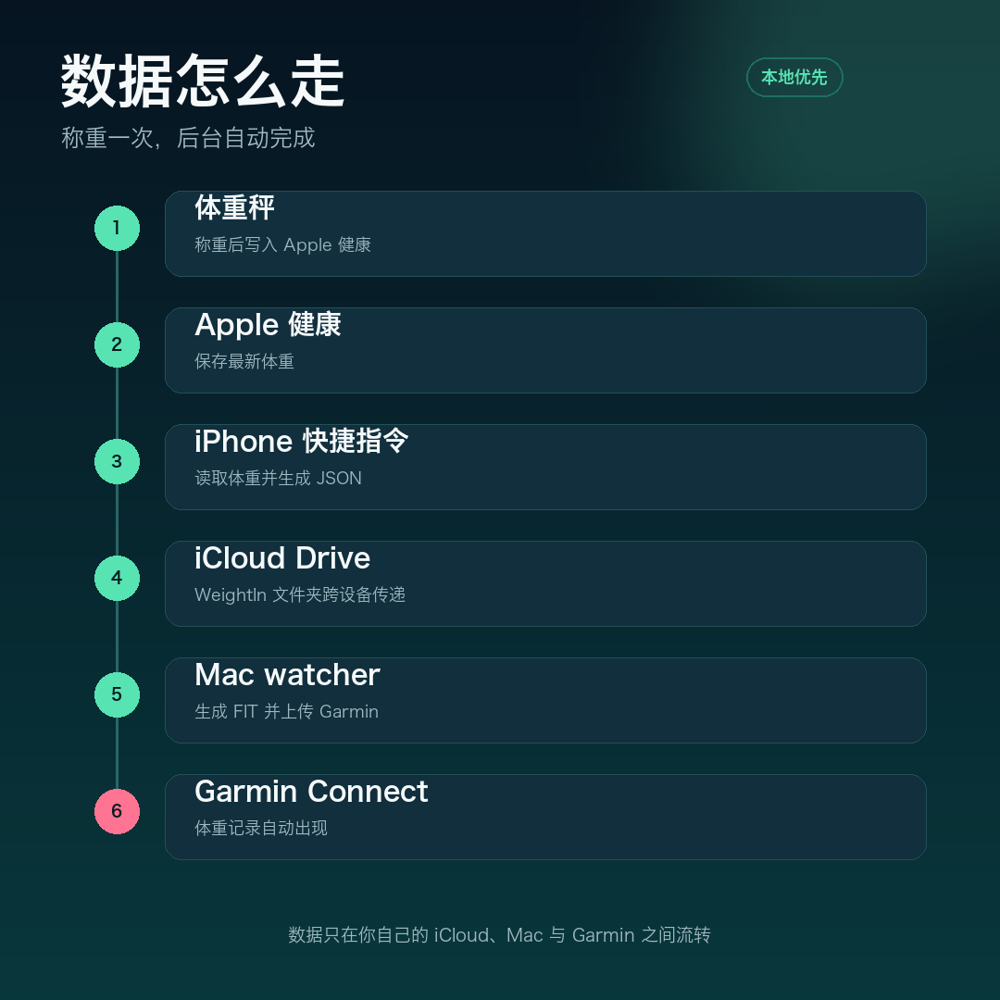
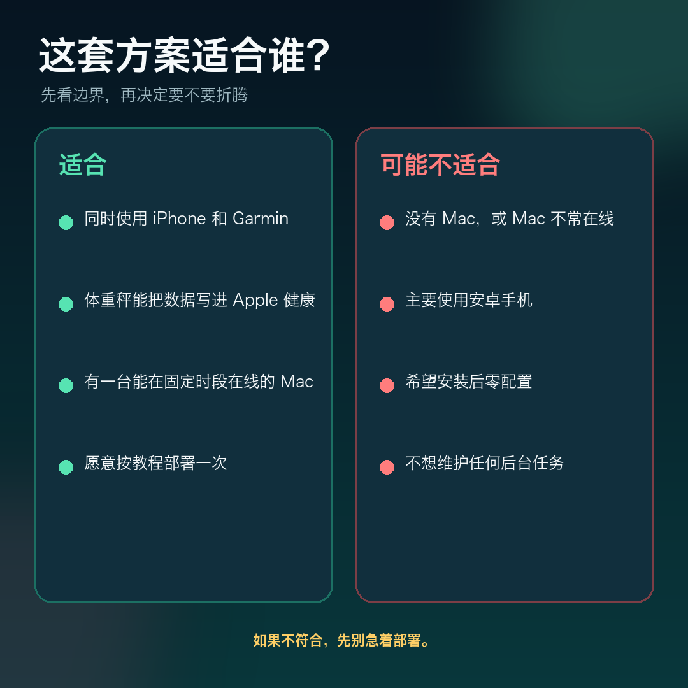
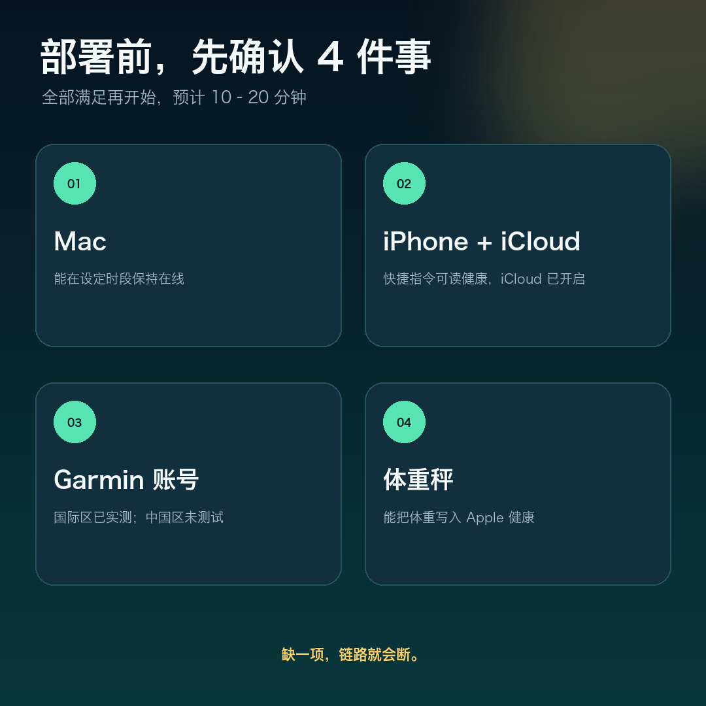
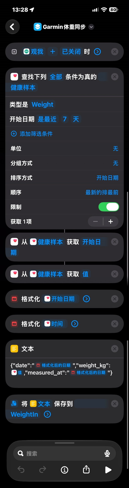

# 佳明不读苹果健康的体重？我做了个免费开源工具

如果你同时用 iPhone、Apple 健康和 Garmin，可能会遇到一个很割裂的瞬间：

刚刚称完体重，Apple 健康里已经有数据，但 Garmin Connect 里还是空的。

不是秤的问题，也不是 Garmin 没有体重功能，而是这条数据链路没有自动接上。

我做了个小工具：**GarminWeightSync4iCloud**。它把体重从 Apple 健康自动送到 Garmin Connect，当前版本 v1.0.0，MIT 开源。

## 现在的流程：称完，关 App，结束

我使用 ScaleMe 和蚂蚁阿福联名秤。称重后，体重会写入 Apple 健康。

接下来的事情由系统自动完成：

体重秤 → Apple 健康 → iPhone 快捷指令 → iCloud Drive → Mac → FIT 文件 → Garmin Connect

我只需要称重，然后关闭 ScaleMe。Mac 会在设定的时间窗口内扫描文件、生成 FIT 并上传；确认成功后，iCloud 里的临时文件也会被删除。



这条链路最重要的两个特点：

- 全程不需要每天手动填数字。
- 数据不经过我的服务器，只在你自己的 iCloud、Apple 设备、Mac 和 Garmin 之间流转。

## 它不是一个 App，而是一条本地自动化链路

项目由四个部分组成：

- `watcher.py`：扫描 iCloud 中的称重文件，生成 FIT 并上传 Garmin。
- `fit_weight.py`：只用 Python 标准库生成 FIT 体重文件。
- `login_once.py`：一次性登录 Garmin，缓存 token；密码不落盘。
- iPhone 快捷指令：从 Apple 健康读取最新体重，写入 iCloud。

Mac 端通过 launchd 每 60 秒唤醒一次 watcher。默认只在早上 5:00–9:00 和晚上 20:00–22:00 处理，避免 Mac 全天高频率扫描。

同一天、同体重的文件不会重复上传。上传失败会保留源文件，下一轮继续重试。

## 适合谁，不适合谁

这套方案有明确边界，不是所有人都适合。



如果你同时使用 iPhone 和 Garmin，体重秤能把数据写进 Apple 健康，并且有一台在固定时段在线的 Mac，这套方案会比较顺手。

如果没有 Mac，或者希望安装后完全零配置，它可能不是最合适的选择。

## 部署前，先确认这 4 件事



第一，Mac 能在设定时段内保持在线。

第二，iPhone 快捷指令有读取 Apple 健康的权限，并且 iCloud Drive 已开启。

第三，你有一个 Garmin Connect 账号。目前实测的是国际区账号，中国区还没有测试。

第四，体重秤能把体重写入 Apple 健康。只要满足这一点，不一定非得使用同款秤。

## 最短部署路径

完整步骤比较长，这里先给一个最短路径。

第一步，在 Mac 上获取代码并创建虚拟环境：

```bash
git clone https://github.com/elingsoft/GarminWeightSync4iCloud.git ~/GarminWeightSync
cd ~/GarminWeightSync
python3 -m venv venv
./venv/bin/pip install garminconnect curl_cffi
```

第二步，登录一次 Garmin：

```bash
GARMIN_EMAIL=你的Garmin邮箱 ./venv/bin/python scripts/login_once.py
```

密码通过 `getpass` 输入，不会保存到文件。开启双重验证的账号会再提示输入验证码。

第三步，复制并修改 launchd 模板：

```bash
cp ~/GarminWeightSync/scripts/com.user.weighin.plist ~/Library/LaunchAgents/
```

需要修改 Python 路径、`watcher.py` 路径、工作目录、日志路径和 `GARMIN_EMAIL`。模板里的路径是旧目录，不能直接加载。

第四步，按照 README 的说明创建 iPhone 快捷指令，把 JSON 保存到 iCloud Drive 的 `WeightIn` 文件夹。



这张截图展示的是包含可选 `measured_at` 字段的版本。iOS 保存文本时可能会自动把 `.json` 改成 `.txt`，watcher 两种后缀都接受。

第五步，真实称重一次，检查 Garmin Connect、`Logs/weighin.log` 和 `WeightIn` 文件夹。

更完整的命令、排错和配置说明在项目文档里，建议不要只照文章手抄。

## 我踩过的 5 个坑

**第一，iOS 会偷偷补 `.txt`。** 保存文件时，子路径写的是 `.json`，落盘可能变成 `.txt`。项目同时接受这两种后缀。

**第二，两个“格式化日期”容易选错。** 日期和日期时间可能同名，带 `T` 和时区偏移的那个才是 `measured_at` 需要的时间。

**第三，token 必须显式落盘。** garminconnect 0.3.x 只有在传入 `tokenstore` 时才会读取和保存 token，裸 `login()` 只在内存里有效。

**第四，iCloud 文件可能还没下载到本地。** 文件太新、只有云端占位文件，或者同步延迟，都会让 watcher 暂时跳过。

**第五，去重看的是本地账本。** `Logs/uploaded.json` 记录每个日期的体重；删掉 Garmin 里的记录并不会自动重置账本。想重新测试，需要同时处理账本。

## 隐私和数据路径

密码只在终端里输入一次，不写入代码、plist 或日志。

Garmin token 保存在 `~/.garminconnect/garmin_tokens.json`，权限为 0600。

体重文件通过你自己的 iCloud 账户同步到自己的 Mac，再由 Mac 直接上传 Garmin。项目没有服务端组件。

部署前仍建议检查 `.gitignore`，不要把 `Logs/`、`venv/`、token 文件、真实邮箱或体重数据提交到公开仓库。

## 它现在还不是什么

它目前只同步体重，不同步体脂、肌肉等指标。

它需要一台在设定时段在线的 Mac，不是纯云端服务。

它不是一个开箱即用的商业 App，需要按教程完成一次部署。

当前代码只根据上传调用是否抛异常判断成功，还没有解析 Garmin 返回里的 `detailedImportResult.failures`。这是后续需要补上的可靠性缺口。

Garmin 中国区账号还没有测试，国际区账号是当前的主要验证环境。

## 开源地址

项目已经发布 v1.0.0，采用 MIT 协议：

https://github.com/elingsoft/GarminWeightSync4iCloud

v1.0.0 Release：

https://github.com/elingsoft/GarminWeightSync4iCloud/releases/tag/v1.0.0

公众号回复「**体重**」，可以获取项目地址、中文 README 和部署文档。

如果你已经在用类似方案，或者有不同品牌的秤和 Garmin 组合，欢迎到 GitHub 提交 Issue，告诉我你的设备组合和遇到的问题。

如果这篇文章帮你少点了几下，也欢迎给项目一个 Star。

---

项目作者：Zhubao Wang  
项目协议：MIT License  
说明：本项目为个人开源项目，与 Garmin、Apple 无隶属或官方合作关系。
